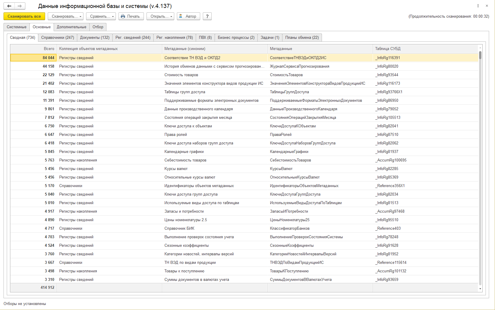
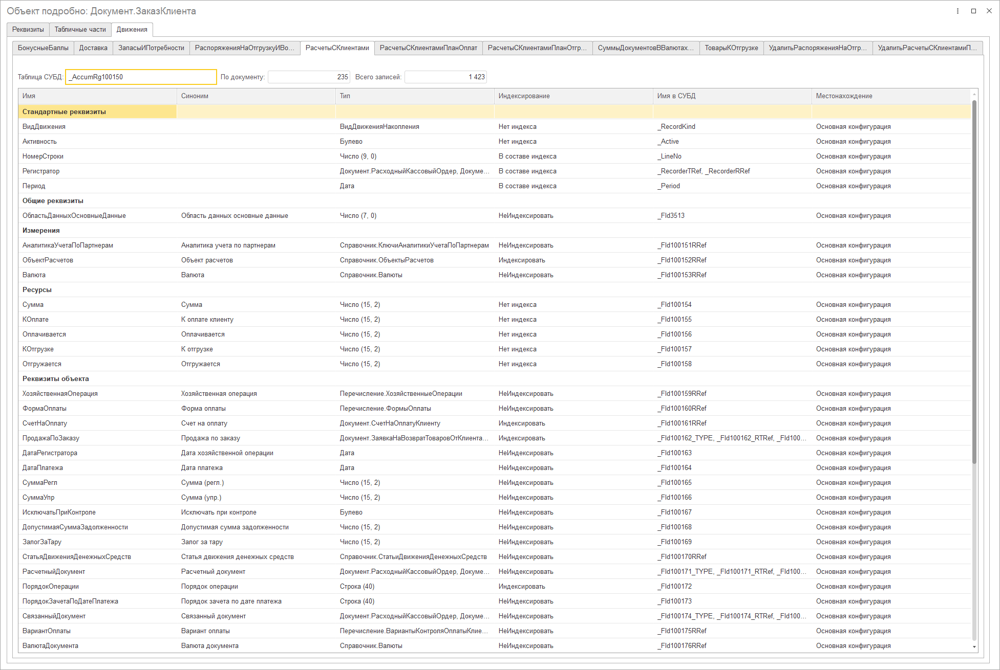
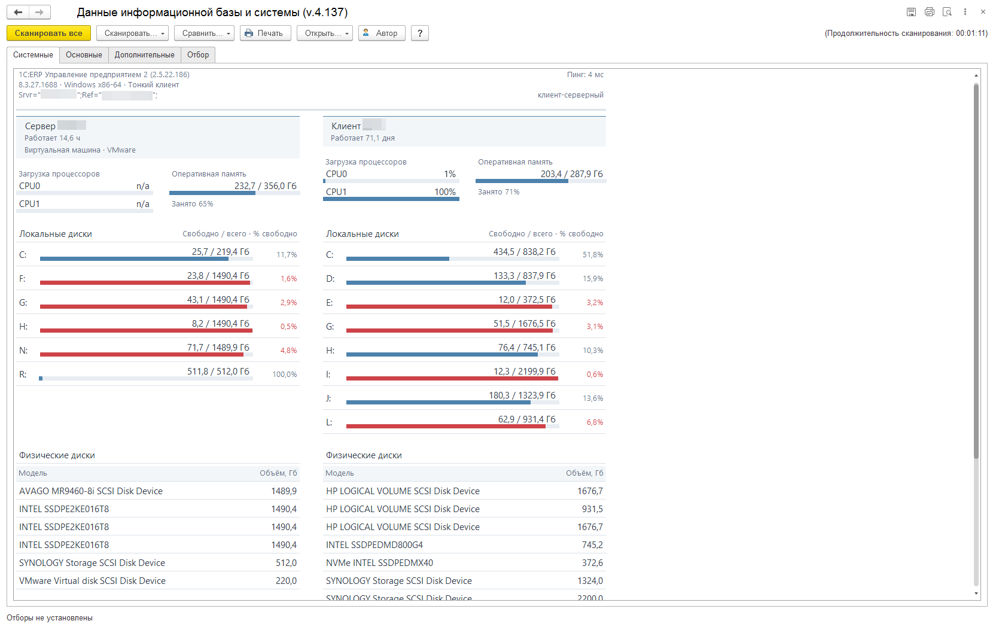

# Данные информационной базы и системы

Внешняя обработка для 1С:Предприятия: показывает, чем заполнена база, сравнивает количество записей между сканами, раскрывает структуру объектов и собирает сведения о клиенте и сервере.

**Версия 4.137 · Обычное и управляемое приложения · 1С 8.2 / 8.3**

**[Скачать готовую обработку](https://github.com/FFXEka/onec-infobase-inspector/releases/latest)** · [Инструкция](docs/USAGE.md) · [Исходники и сборка](docs/BUILD.md) · [Сообщить об ошибке](https://github.com/FFXEka/onec-infobase-inspector/issues/new/choose)

## Когда пригодится

- **Разобраться в незнакомой базе.** Посмотреть количество записей по справочникам, документам и регистрам, затем перейти к списку нужного объекта.
- **Проверить количественный результат загрузки или обмена.** Запомнить скан, выполнить операцию и посмотреть, где изменилось количество записей. Сравнение не проверяет содержимое записей: одинаковое количество ещё не означает одинаковые данные.
- **Найти сведения для диагностики.** Посмотреть поля и табличные части объекта, связанные регистры, доступные физические имена таблиц и полей СУБД, характеристики клиентского и серверного компьютеров.

## Возможности

| Раздел | Что можно посмотреть |
|---|---|
| Основные таблицы | Количество записей по объектам метаданных, доступные дополнительные счётчики, сводная таблица |
| Сравнение | Разница количеств с сохранённым сканом; эталон в памяти или файле MXL |
| Объект подробно | Реквизиты, табличные части, движения документов и зависимые объекты |
| Списки | Штатные и универсальные списки; в управляемом универсальном списке можно включить счётчики строк табличных частей |
| Дополнительные сведения | Организации, хронология документов, константы, оборудование, расширения и библиотеки — при наличии в конфигурации |
| Системные сведения | Доступные сведения о базе, платформе, клиенте и сервере, памяти, процессорах и дисках |
| Печать | Табличный документ по собранным данным |

### Системная информация сервера и клиента

На одной странице показаны сервер и клиент: время работы, доступная загрузка процессоров, использование памяти, свободное место и модели дисков. Для распознанной виртуальной среды выводится тип виртуализации. Имена компьютеров и параметры подключения на скриншоте скрыты.

На иллюстрациях показана версия 4.137. Значения относятся к базе на момент снимка и не являются замером производительности для других баз.

## Быстрый старт

1. Откройте [последний выпуск](https://github.com/FFXEka/onec-infobase-inspector/releases/latest) и скачайте комплект ZIP с EPF и лицензиями либо отдельный файл `ДанныеИнформационнойБазыИСистемы_4_137.epf`.
2. Запустите нужную базу 1С под пользователем с **полными правами**.
3. Откройте EPF стандартной командой открытия файла. Встраивать обработку в конфигурацию не требуется.
4. Выберите **Сканировать… → Основные**. При необходимости предварительно задайте период и организацию на вкладке **Отбор**.
5. Выберите строку и используйте **Открыть… → Основную форму списка**, **Универсальную форму списка** или **Объект подробно**.

Дополнительные и системные сведения собираются отдельными командами. **Сканировать все** запускает все этапы, начиная с системных сведений.

## Совместимость и ограничения

- Предусмотрены 1С 8.2 и 8.3, обычное и управляемое приложения, файловые и клиент-серверные базы. Конкретные проверки и их границы перечислены в [COMPATIBILITY.md](docs/COMPATIBILITY.md).
- Доступность дополнительных сведений зависит от конфигурации; системных — от ОС, безопасного режима и разрешений. Веб-клиент не предоставляет полные характеристики клиентского ПК.
- Обработка обращается к данным через 1С. Прямое подключение к СУБД не требуется. Размер серверной базы и размеры её таблиц не определяются.
- Подсчёт записей на больших базах может занять время. Счётчики табличных частей в управляемом универсальном списке по умолчанию выключены.
- Сканирование читает данные. **Запись возможна по явной команде** в редакторе констант или открытой штатной форме конфигурации.
- Сканы, печатные файлы и снимки экрана могут содержать сведения организаций, значения констант, имена компьютеров и пути к базам. Проверяйте их перед передачей другим людям.

Подробная справка встроена в EPF; её копия доступна в [docs/help.html](docs/help.html). Для чтения HTML скачайте файл и откройте в браузере.

## Обратная связь

Ошибки и предложения можно оставить в [Issues](https://github.com/FFXEka/onec-infobase-inspector/issues). Для воспроизведения ошибки полезны версия платформы, конфигурация, вид клиента и последовательность действий. Правила внесения изменений — в [CONTRIBUTING.md](CONTRIBUTING.md).

Если обработка пригодилась, можно поддержать проект звездой на GitHub.

## Автор и лицензия

Автор — **Дмитрий Сушков**: [GitHub](https://github.com/FFXEka) · [Инфостарт](https://infostart.ru/profile/510125/).

[Публикация на Инфостарте](https://infostart.ru/1c/tools/2384488/).

Авторский код распространяется по **GNU GPL версии 3** (`GPL-3.0-only`), без гарантий. Полный текст — [LICENSE](LICENSE), уведомление об авторстве — [COPYRIGHT](COPYRIGHT).

Анимация ожидания из «1С:Библиотеки стандартных подсистем» сохраняет лицензию **CC BY 4.0** и авторство фирмы «1С»: [THIRD_PARTY_NOTICES.md](THIRD_PARTY_NOTICES.md). Платформа 1С и типовые конфигурации в поставку не входят.
